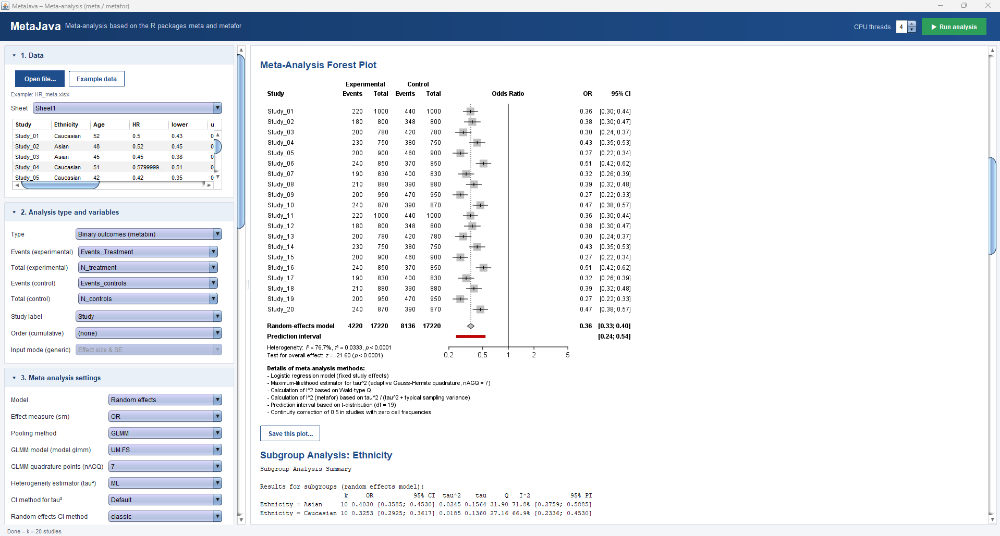

# MetaJava — meta-analysis in Java, following the R packages meta and metafor

[](https://github.com/tarak-dhaouadi/metajava/actions/workflows/check.yaml)
[-blue.svg)](LICENSE.md)
[](https://adoptium.net/)

A stand-alone desktop application (Java Swing, **no R and no external libraries needed**) for meta-analysis.
Pooling, heterogeneity, prediction intervals, subgroup analysis, meta-regression, publication-bias tests and
forest/funnel plots follow the R package [meta](https://cran.r-project.org/package=meta) (developed against
meta 8.5-0); outlier and influence diagnostics follow [metafor](https://cran.r-project.org/package=metafor)
(Viechtbauer & Cheung, 2010).

* Eight analysis types (`metabin`, `metacont`, `metacor`, `metagen`, `metainc`, `metamean`, `metaprop`, `metarate`).
* Reads `.xlsx`, `.csv`, `.tsv` and `.txt` files; the results update automatically when a setting changes.
* **Load project / Save project** (buttons under the title bar) keep a whole session in a `.json` file: data, column assignments and all settings.
* Exports: results tables to Excel (`.xlsx`, one sheet per section), the whole output (paragraphs, tables, figures) to Word (`.docx`), plots as PNG, TIFF, JPG, SVG and PDF, and the text output as `.txt`.
* Forest plots (main and subgroup), leave-one-out, cumulative, funnel (optionally contour-enhanced), bubble, Baujat,
  radial (Galbraith), L'Abbé, Doi (with LFK index) and influence-diagnostics plots, drawn in the style of R; PNG, TIFF, JPG, SVG and PDF export (resolution in dpi for the raster formats).



## Run it

Requires only a Java runtime, **11 or later** (the JAR is compiled for Java 11, class-file version 55, and the
`check` workflow builds and tests it on Java 11, 17 and 21):

1. Download `metajava-0.1.0.jar` from the [Releases](https://github.com/tarak-dhaouadi/metajava/releases) page.
2. Double-click the JAR, or run:

```
java -jar metajava-0.1.0.jar
```

In the application: **Open file…** (or **Example data**), choose the analysis type, assign the columns of your
file to each parameter, adjust the settings, press **Run analysis**.

## Data format

One row per study with a header row. Column names are free: you map each column to a parameter in section
*2. Analysis type and variables* (obvious names such as `event.e`, `n_treatment`, `TE`, `seTE` are guessed
automatically).

| Analysis type | Parameters to assign |
|---|---|
| Binary outcomes (`metabin`) | events and total, experimental and control |
| Continuous outcomes (`metacont`) | N, mean, SD, experimental and control |
| Correlations (`metacor`) | correlation, sample size |
| Generic (`metagen`) | effect size TE (log scale for ratios) and standard error, **or** the effect and its confidence limits on the natural scale (*Input mode*); optional N experimental / control |
| Incidence rates (`metainc`) | events and person-time, experimental and control |
| Single means (`metamean`) | N, mean, SD |
| Single proportions (`metaprop`) | events, total |
| Single rates (`metarate`) | events, person-time |

Optional columns: **study label**, **subgroup variable** (subgroup analysis), **order** (cumulative analysis), and
any numeric or categorical column used as a **covariate / factor** in meta-regression.
The bundled example (`Example data`) is `src/main/resources/examples/HR_meta.xlsx` (20 hazard ratios, with
`Ethnicity` and `Age` columns).

## Options

### Effect measures (`sm`)

| Type | Choices (default first) |
|---|---|
| binary | RR, OR, RD, ASD, DOR, VE |
| continuous | MD, SMD, ROM (SMD method: Hedges, Cohen, Glass; optional pooled variance for MD) |
| correlations | ZCOR (Fisher's z, back-transformed to r), COR |
| generic | HR, OR, RR, IRR, MD, SMD, RD, ZCOR, COR, MRAW, PLOGIT, PLN, PRAW, PAS, PFT, IR, IRLN, ROM, or none |
| incidence rates | IRR, IRD, IRSD, VE |
| single means | MRAW, MLN |
| single proportions | PLOGIT, PLN, PRAW, PAS, PFT |
| single rates | IR, IRLN, IRS, IRFT |

### Pooling method

* binary: Inverse, MH, Peto, SSW (sample size), LRP (penalised logistic regression, `sm = OR`), GLMM
* incidence rates: Inverse, MH, Cochran, GLMM
* single proportions and single rates: Inverse, GLMM (`PLOGIT` / `IRLN`)
* everything else: Inverse

GLMM follows `metafor::rma.glmm(method = "ML")` as used by meta: tau² by maximum likelihood, Wald z/t intervals,
Wald-type and likelihood-ratio heterogeneity tests (for UM.RS the Wald statistic is the Wald test of the saturated model with random study intercepts, as in metafor), no study weights. Models (`model.glmm`): UM.FS (default),
UM.RS, CM.EL, CM.AL for OR; UM.FS, UM.RS, CM.EL for IRR; UM.FS for proportions and rates; adaptive
Gauss-Hermite quadrature with `nAGQ` points (default 7). Selecting GLMM or LRP sets the compatible effect
measure, tau² estimator and interval methods automatically.

### Model and heterogeneity

* **Model:** random effects, common effect, or both.
* **tau² estimator:** REML (default), DL, PM, ML, HS, SJ, HE, EB.
* **CI for tau²:** default (Q-profile; Jackson for DL), QP, BJ, J, or none.
* **Random-effects CI method:** classic, HK (Hartung-Knapp), KR (Kenward-Roger); **ad hoc HK variance
  correction:** none, `se`, `ci`, IQWiG6.
* **Common-effect CI method:** classic, IVhet.
* **I² computed from:** Q (default) or tau².
* **Confidence level**, **null effect** (natural scale), **back-transformation** of results, **scale factor**
  for proportions and rates, **title**.
* **Individual-study CI method** (where applicable to the analysis type): default, z, t, CP, WS, WSCC, AC, SA, SM, exact.
* **Continuity correction:** increment (default 0.5) applied to studies with a zero cell (*only 0*), to all
  studies if any has a zero (*if 0 all*), or to all; MH.exact; inclusion of studies with zero events in both arms.

### Prediction interval

Enable **Prediction interval** in *3. Meta-analysis settings*. All eight methods of `meta` are implemented:

| Method | Interval |
|---|---|
| `V` (default) | t-distribution, k − 1 degrees of freedom |
| `HTS` | t-distribution, k − 2 degrees of freedom (Higgins, Thompson & Spiegelhalter) |
| `HK` | Hartung-Knapp variance, t-distribution, k − 1 df |
| `HK-PR` | Hartung-Knapp variance, t-distribution, k − 2 df |
| `KR` | Kenward-Roger variance and degrees of freedom |
| `KR-PR` | Kenward-Roger variance, degrees of freedom − 1 |
| `NNF` | parametric bootstrap (Nagashima, Noma & Furukawa, 2019) |
| `S` | normal distribution |

An **ad hoc HK correction for the PI** (none / `se`) is available for the `HK` methods. With GLMM and LRP only
`V`, `HTS` and `S` can be used. Intervals need at least 2 studies (`HTS` and the `-PR` variants need 3).

**PI confidence level** is set separately from the confidence level of the effect (default **95 %**). A different
value (e.g. 99) is used everywhere: the results text (*Prediction interval (99%)*, column *99% PI*), the
subgroup table, leave-one-out table and the forest plots (row label *Prediction interval (99%)*).

### Forest plot

Sort by effect size, standard error, weight or study label (ascending/descending); show or hide the overall
effect test, heterogeneity statistics (with optional CIs for I² and tau²) and *Analysis details* (the "Details of
meta-analysis methods" block); left/right axis labels, number of digits, row spacing.
The x-axis is **centred on the null value** (1 for ratios such as OR, RR, HR, IRR; 0 for MD, SMD, RD, correlations),
as in `meta::forest`; for single means, proportions and rates, which have no natural null value, the axis is not centred.

### Subgroup analysis (section 5)

* **Subgroup variable**, subgroup analysis on/off, assumption of a common tau² across subgroups.
* **Subgroup prediction interval:** draws the prediction interval of each subgroup in the subgroup forest plot,
  independently of the main *Prediction interval* option (which controls the overall interval only).
* **Test for effect in subgroup:** adds *Test for effect in subgroup: z = …, p = …* under each subgroup.
* **Details of meta-analysis methods** under the subgroup forest plot.
* The *Results for subgroups* table (random-effects model) always includes a **prediction interval column**
  (*95% PI* by default, *99% PI* when the PI level is 99), together with k, estimate, CI, tau², tau, Q, I² and the
  test for subgroup differences.

### Meta-regression (section 6)

Several numeric **covariates** and/or categorical **factors** (choose *none* to leave a list empty; *none* is
exclusive), intercept on/off, bubble plot with regression line (one numeric covariate), Hartung-Knapp
(*knha*) tests when the HK CI method is selected. Output follows `metafor::rma.uni`: logLik, deviance, AIC, BIC,
AICc, tau², I², H², R², QE, QM and the coefficient table.

### Other analyses

* **Leave-one-out** and **cumulative** meta-analysis (ordered by a chosen column), with forest plots.
* **Publication bias:** funnel plot (contour-enhanced option, study labels), tests for funnel plot asymmetry
  (Egger, Begg, Thompson, Harbord, Peters, Macaskill, Deeks, Pustejovsky, Schwarzer; the default depends on the
  data type) with plot, Duval-Tweedie **trim-and-fill** (side auto/left/right; estimator L0 or R0).
* **Diagnostics:** outlier and influence diagnostics (rstudent, dffits, Cook's distance, cov.r, tau2.del, QE.del,
  hat, weight, dfbetas); studies flagged as influential/outliers are drawn as **red points** in the eight-panel
  plot, as in metafor. Baujat plot, radial (Galbraith) plot, L'Abbé plot (binary outcomes). Publication bias also offers the Doi plot with the LFK index.
* **Export:** every plot as PNG, TIFF, JPG, SVG or PDF (resolution 72–1200 dpi for PNG/TIFF/JPG and recorded in the file; SVG and PDF are resolution independent and written at the plot's natural size), all results as a `.txt` file.

## Not implemented

Drapery, L'Abbé, Doi and LFK plots; a multi-model meta-regression builder; SVG/PDF export; `metacr`, `metabind`
and cumulative analysis by cluster; three-level models.

## Validation

`SelfTest` (run by `./build.sh --test` and by the `check` workflow) compares the analysis with forest plots printed
by R `meta` (hazard ratios from lnHR/SE; correlations from Fisher's z/SE; DerSimonian-Laird tau², normal-distribution
prediction interval): pooled estimate, confidence interval, I², tau², z statistic and prediction interval at the printed
precision. It also checks the prediction-interval level in the text output and the subgroup table, which forest
rows are drawn for each combination of the *Prediction interval* and *Subgroup prediction interval* options, and the red
flag in the influence plot.

During development the application was also compared with R output (not part of `SelfTest`): the HR example (pooled
HR, z, prediction interval, tau² with Jackson CI, I²/H CIs, Q, subgroups, Qb, leave-one-out, Egger test,
meta-regression), REML RR/OR (metafor), MH RR and DL influence diagnostics for the BCG data, LRP against
`meta::metabin` (dat.nielweise2007) and GLMM models against `metafor::rma.glmm`.

The Swing front end is a thin layer over the tested core; please report anything odd you see on your machine.

## Build

```
./build.sh --test        # Linux / macOS, needs a JDK 11+ (javac, jar); no Maven, no downloads
build.bat --test         # Windows
mvn package              # alternative, if you use Maven
```

The result is `dist/metajava-0.1.0.jar`.

## Licence and attribution

GPL-2.0-or-later (see [LICENSE.md](LICENSE.md) and [COPYRIGHTS.md](COPYRIGHTS.md)), compatible with the GPL (≥ 2)
R packages meta and metafor whose methods it re-implements. If you use MetaJava, please see
[CITATION.cff](CITATION.cff) and cite meta and metafor as well.
